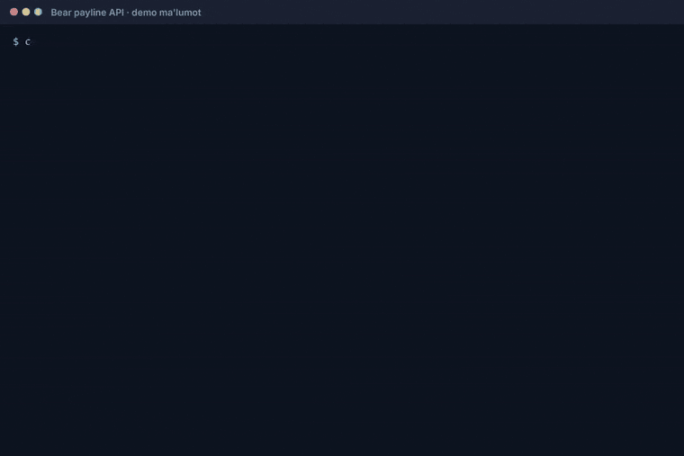
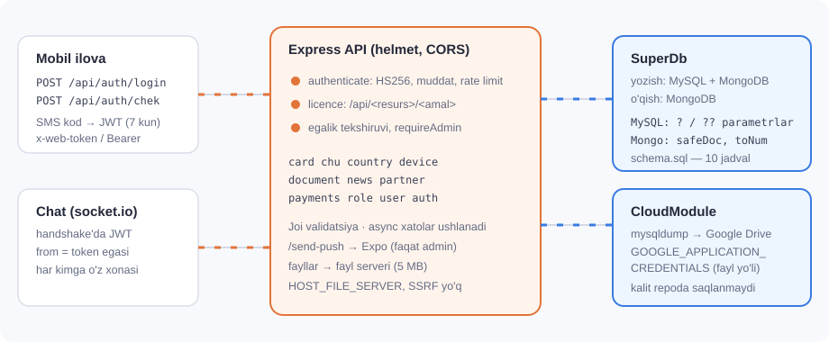

<div align="center">

# Bear payline

Karta, to'lov, hamkor va yangiliklar uchun REST API. Kirish SMS kod orqali, chat socket.io orqali, push xabarlar Expo orqali ishlaydi.


[Qanday ishlaydi](#qanday-ishlaydi) ·
[API](#api) ·
[O'rnatish](#ornatish) ·
[Xavfsizlik](#xavfsizlik-va-cheklovlar) ·
[Oldin va keyin](#optimizatsiya-oldin-va-keyin) ·
[Tuzilish](#loyiha-tuzilishi)



</div>

> [!NOTE]
> Demo va screenshotdagi barcha ma'lumotlar o'ylab topilgan: `DEMO MIJOZ`, kartalar `8600 **** **** 0001`, telefonlar `+998000000xxx`, e-pochtalar `@example.uz`. Ular bir martalik MariaDB'da yaratilgan. GIF'dagi javoblar shu demo ishga tushirishda saqlangan haqiqiy API javoblari.

## Qanday ishlaydi



1. **Kirish.** `POST /api/auth/login` telefon raqamini tekshiradi va SMS kod yuboradi. `POST /api/auth/chek` kodni tekshirib JWT qaytaradi. JWT 7 kun amal qiladi.
   - Kod `crypto.randomInt` bilan yaratiladi va 10 daqiqa amal qiladi.
   - Har bir kod faqat bir marta ishlatiladi, 5 marta noto'g'ri kiritilsa bloklanadi.
2. **Har bir so'rov** quyidagi tekshiruvlardan o'tadi:
   - `authenticate`: HS256, muddat, foydalanuvchiga 1 soniyada 100 so'rov;
   - `licence`: rol litsenziyasidan `/api/<resurs>/<amal>` bo'yicha ruxsat;
   - egalik tekshiruvi: foydalanuvchi faqat o'z kartasi, to'lovlari va hujjatlarini ko'radi.
3. **SuperDb** yozuvni MySQL va MongoDB'ga yozadi, o'qishni MongoDB'dan qiladi. CloudModule `mysqldump` orqali zaxira olib, uni Google Drive'ga yuklaydi.
4. **Chat** (socket.io). Ulanishda JWT tekshiriladi. Xabarning yuboruvchisi har doim token egasi bo'ladi. Har bir foydalanuvchining o'z xonasi bor.

### Litsenziya formati

Rolning `licence` maydoni JSON qatori sifatida saqlanadi. Masalan: `{"card":["get"],"payments":["get","add"]}`. Hamma ruxsatlar uchun `"*"` yoziladi. JSON o'qib bo'lmasa, kirish rad etiladi.

## API

Bazaviy yo'l `/api/<resurs>`. `uptade` so'zi asl kodda shunday yozilgan, mobil ilovalar bilan moslik uchun o'zgartirilmagan.

| Resurs | Yo'llar | Kim |
|---|---|---|
| `auth` | `POST /login`, `POST /chek` | hamma (rate limit) |
| `card` | `GET /get/card/:id`, `GET /get/all`, `POST /add`, `PUT /uptade/:id`, `DELETE /delete/:id` | egasi; `get/all` faqat admin |
| `chu` (card_has_user) | karta va foydalanuvchi bog'lanishi | egasi |
| `payments` | `GET /get/payments/:id`, `GET /get/user/:id`, `GET /get/all`, `POST /add`, `PUT /uptade/:id`, `DELETE /delete/:id` | egasi; `uptade/delete` va `get/all` faqat admin |
| `user` | `GET /get/user/:id`, `GET /get/role/:id`, `GET /get/country/:id`, `GET /get/all`, `POST /add`, `PUT /uptade/:id`, `DELETE /delete/:id` | o'zi; qo'shish, o'chirish va `get/all` faqat admin |
| `partner`, `document`, `device` | `get`, `add`, `uptade`, `delete` | egasi |
| `news`, `country` | `GET /get/all` ochiq; o'zgartirish | faqat admin |
| `role` | CRUD | faqat admin |
| `POST /send-push` | Expo push | faqat admin, rate limit |

| Holat | Ma'nosi |
|---|---|
| 400 | Joi validatsiyasi yoki noto'g'ri JSON |
| 401 | Token yo'q, noto'g'ri yoki muddati o'tgan |
| 403 | Litsenziya, egalik yoki admin huquqi yetmaydi |
| 429 | Rate limit |

## O'rnatish

Asosiy ilova `sourse-code 1.2/2-OY/Bear payline` papkasida. Talablar: Node.js 18+, MySQL (yoki MariaDB) va MongoDB.

```bash
cd "sourse-code 1.2/2-OY/Bear payline"
npm install
cp .env.example .env
npm start            # http://localhost:3000
```

```bash
npm test             # 50 ta unit test (node:test)
```

MySQL sxemasi `server/SuperDb/CloudModule/schema.sql` faylida. Unda 11 ta jadval bor, ma'lumot yo'q. Chat uchun kerak bo'lgan `message` jadvali shu jumlaga kiradi.

> [!IMPORTANT]
> Ilova klassik `mysql` 2 drayverini ishlatadi. U MySQL 8 dagi standart `caching_sha2_password` bilan ulana olmaydi, shuning uchun ilova foydalanuvchisini `IDENTIFIED WITH mysql_native_password` bilan yarating. MySQL 9 da bu usul yo'q: MySQL 8.0 yoki MariaDB ishlating.

| O'zgaruvchi | Vazifasi |
|---|---|
| `JWT_SECRET` | JWT kaliti, kamida 16 belgi (majburiy) |
| `MYSQL_HOST`, `MYSQL_PORT`, `MYSQL_USER`, `MYSQL_PASSWORD`, `MYSQL_DATABASE` | MySQL (majburiy) |
| `MONGO_URI` | MongoDB (majburiy) |
| `SMS_URL`, `SMS_LOGIN`, `SMS_PASSWORD`, `SMS_FROM` | SMS provayderi |
| `GOOGLE_APPLICATION_CREDENTIALS`, `GOOGLE_DRIVE_FOLDER_ID` | Zaxirani Drive'ga yuklash (JSON kalit **fayl yo'li**) |
| `HOST_FILE_SERVER` | Fayl serveri manzili |
| `CORS_ORIGINS`, `TRUST_PROXY`, `PORT` | Tarmoq sozlamalari |
| `BOT_TOKEN`, `SMS_TEST_PHONE` | Eski modullar (`file server`, `sms`) uchun |

Majburiy o'zgaruvchi berilmasa, server yetishmayotgan nomlarni o'zbekcha ro'yxat qilib to'xtaydi.

## Xavfsizlik va cheklovlar

> [!NOTE]
> Git tarixi 2026-11-26 da `git filter-repo` bilan tozalandi.
> - Tarixdan o'chirilgan fayllar: `keyGoogle` (Google service account kaliti), `.git.zip` arxivlari, SQL dump, `uploads` va `sms/img`.
> - Kodga yozilgan MySQL, MongoDB va SMS parollari, JWT kalitining zaxira qiymati, Telegram bot tokeni va Google `private_key_id` `***REMOVED***` bilan almashtirildi.
> - Commit SHA'lari o'zgardi: eski klonlarni qayta klon qiling.

Qolgan xavflar:
- **CVV ochiq saqlanadi.** `card.cvv` ustuni `NOT NULL`. Karta ma'lumotlarini saqlash PCI DSS talablariga zid, bu alohida qaror talab qiladi.
- **Token bekor qilinmaydi.** Token ichida rol va litsenziyaning nusxasi saqlanadi. Rol o'zgarsa ham, eski token muddati tugaguncha (7 kun) ishlayveradi.
- **Tranzaksiya yo'q.** MySQL va MongoDB'ga yozish atomar emas. MongoDB'da `id` uchun unique index yo'q.
- **`npm audit` (prod): 5 ta topilma.**
  - 1 critical: `mysqldump` → `mysql2`, faqat zaxira moduli.
  - 4 moderate: `googleapis` va `uuid`.
  - Ularni tuzatish uchun major versiyaga o'tish kerak.
- **Eski nusxalar** (`1-OY/*`, `2-OY/sever`, `2-OY/file server`, `sms`) dan faqat sirlar olib tashlangan. Ularda SQL injection va auth xatolari hali bor. `soket server/` (demo socket va push relay) himoyalanmagan.
- **Mavjud klientlar.** `get/all`, rol va mamlakatni o'zgartirish endi faqat admin uchun ochiq. Bu eski klientlarga ta'sir qilishi mumkin. Production'dagi rollarning `licence` maydoni yuqoridagi formatda bo'lishi kerak.
- **Manfiy summa.** `payments` da `amout: -100` qabul qilinadi: Joi sxemasida `positive()` yo'q. Bu biznes qoidasi bo'yicha qaror talab qiladi.
- **Xom DB xabarlari.** 400 javobida MySQL xabari mijozga ketadi, masalan `Data too long for column 'number'`.
- **Uzunliklar mos emas.** Karta raqamiga Joi 30 belgigacha ruxsat beradi, MySQL esa 20. Mongo'da rol `licence` 150 belgi, MySQL'da 250.
- **Karta bog'lanishlari.** Karta o'chirilganda uning `card_has_user` yozuvlari qoladi. Hech kimga bog'lanmagan kartani id'sini bilgan har kim o'ziga bog'lay oladi.
- **Jadval nomi.** `сountry` jadvali nomidagi birinchi harf kirillcha "с". Kod va sxemada bir xil, lekin xato qilish oson.

### Sinov (2026-11-26)

Ilova Docker'siz, haqiqiy MongoDB 8.2.6 (`mongodb-memory-server`) va MySQL 8.0.46 (`mysql-memory-server`) bilan ishga tushirildi. SMS provayder o'rniga lokal stub ishlatildi. Taxminan 90 ta HTTP va socket.io tekshiruvi qilindi:

| Tekshiruv | Natija |
|---|---|
| SMS kirish, noto'g'ri kod, `alg:none` soxta token | ishlaydi; 400; 401 |
| Boshqa foydalanuvchining kartasi, to'lovi, qurilmasi, hujjati | 403 |
| SQL injection (`' OR '1'='1`, `1;DROP TABLE` va boshqalar) | o'tmadi: MySQL general log'da hamma qiymat escape qilingan, barcha jadvallar saqlanib qoldi |
| NoSQL injection (`{"$ne":null}`) | 400 |
| socket.io: tokensiz yoki soxta token | rad etiladi |
| socket.io: uchinchi foydalanuvchi, soxta `from` | boshqalarning xabarini ololmaydi; `from` doim token egasi |
| Server logi | 500 xato, yiqilish va ushlanmagan rejection yo'q |

Bu sinov topgan va tuzatilgan xatolar:

| Muammo | Oldin | Keyin |
|---|---|---|
| Chat | sxemada `message` jadvali yo'q edi: xabar saqlanmas, yetkazilmas, xato ham chiqmasdi | jadval qo'shildi, xabar MySQL va MongoDB'ga yoziladi |
| `GET /api/payments/get/payments/:id` | istalgan foydalanuvchi istalgan to'lovni o'qiy olardi | egasi yoki admin, boshqalarga 403 |
| `card_has_user` `add` / `uptade` | foydalanuvchi o'zini boshqa odamning kartasiga bog'lab, raqam va CVV'ni ko'ra olardi | karta boshqaga bog'langan bo'lsa, 403 (admin bundan mustasno) |

## Optimizatsiya: oldin va keyin

| Ko'rsatkich | Oldin | Keyin |
|---|---|---|
| Auth middleware | birinchi qatori `return next()`, ya'ni **o'chiq** | JWT HS256 + litsenziya + egalik |
| SQL so'rovlar | satrlarni ulash (injection) | `?` / `??` parametrlar, 11 jadval |
| MySQL natijasini kutish | `sleep(5)` bilan polling, ~70 metod | Promise + pool |
| `setTimeout` / `setInterval` hack'lari | 13 | **0** |
| `GET /chat` | har so'rovda yangi `io.on('connection')` | bitta tinglovchi, JWT bilan |
| Async xatolar | Node jarayonini qulatardi (`PUT` handlerlarda ReferenceError) | umumiy xato ishlovchisi |
| SMS kodi | muddati tekshirilmasdi | 10 daqiqa, bir martalik, 5 urinish |
| Mamlakat kodi tekshiruvi | `await` siz, har doim o'tardi; 4 so'rov | 1 so'rov |
| `DELETE /file` (fayl serveri) | ixtiyoriy faylni o'chirardi | faqat `uploads/` ichida |
| `npm audit` (prod) | 39 (3 critical, 19 high) | **5** (1 critical, 4 moderate) |
| Unit testlar | 0 | **50** |
| Kodga yozilgan sirlar | ~20 fayl | **0** |

## Loyiha tuzilishi

```
sourse-code 1.2/
  2-OY/Bear payline/          ← asosiy ilova
    server/index.js           Express + socket.io + Expo push
    server/config.js          .env o'qish va tekshirish
    server/middlewire/        auth (authenticate, licence, requireAdmin), asyncErrors
    server/routers/           card, card_has_user, country, device, document,
                              main, message, news, partner, payments, reg_auth, role, user
    server/SuperDb/           MySqlModule (sql.js), MongoDbModule (safe.js), CloudModule
    server/resurs/funtion/    token, licence, access, rateLimit, safeFile, fileClient …
    server file/              fayl yuklash serveri
    soket server/             demo socket va push relay (himoyalanmagan)
    test/                     node:test (50 ta)
  2-OY/sever, file server, sms
  1-OY/…                      oldingi oy modullari (eski nusxalar)
docs/media/                   README rasmlari
```

Repoda ko'p dublikat bor: 65 ta bir xil fayl guruhi, 176 ta ortiqcha fayl (~1.47 MB). 36 ta `user copy*.js` fayli ham bor. Ular o'chirilmagan.

## Litsenziya

Repoda litsenziya fayli yo'q. Shuning uchun barcha huquqlar muallifda.

## Muallif

**Bobomalikov Abduaziz** · GitHub [@AbduazizBobomalikovNode](https://github.com/AbduazizBobomalikovNode) · tashkilot [abdusoft-uz](https://github.com/abdusoft-uz)
